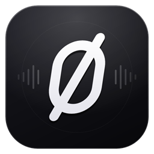

  

<h1 align="center">Nicec0re Music</h1>

  A fast, ad-free music player for <b>Android</b> and <b>Windows</b> with YouTube Music, SoundCloud, synced lyrics and slowed + reverb effects. 
  <i>Rychlý hudební přehrávač bez reklam pro Android a Windows.</i>

  
  

---

## ✨ Features

- 🔎 **One search for everything:** YouTube Music and SoundCloud together
- 🎤 **Synced lyrics** that follow the song line by line, tap a line to jump there
- 🎛️ **Effects:** speed 0.5×–2×, Slowed + reverb, Sped up, Nightcore, adjustable reverb
- 📻 **Radio:** when your queue ends, similar songs keep playing
- ❤️ **Library:** liked songs, your own playlists, history
- ⬇️ **Offline:** download songs and play them without internet
- 📁 **Local files:** MP3, FLAC, M4A, OGG, OPUS, WAV
- 🔁 **Playlist import** from Spotify, Deezer, Apple Music, YouTube and SoundCloud
- 🔒 **Background playback** with lock-screen controls (Android) and media keys (Windows)
- 🚫 No ads, no account, no tracking

## 📥 Download

Go to **[Releases](../../releases/latest)** and download:

| Platform | File |
|---|---|
| Android 6+ | `Nicec0re-Music-x.y.z.apk` |
| Windows 10 / 11 | `Nicec0re-Music-x.y.z-Setup.exe` |

**Android:** open the APK and allow *Install unknown apps*.
**Windows:** if SmartScreen warns you, click *More info → Run anyway*.

## 🛠️ Troubleshooting

Songs don't play? Open **Settings → Diagnostics → Run test** and attach a screenshot to a new [issue](../../issues/new).

## ⚠️ Disclaimer

Nicec0re Music is an independent, unofficial app. It is **not affiliated with** YouTube, Google, SoundCloud, Spotify, Deezer, Apple or LRCLIB. All trademarks belong to their owners. Nicec0re Music does not host any content.

---

## 🇨🇿 Česky

**Nicec0re Music** je hudební přehrávač pro Android a Windows. Hledá na YouTube Music i SoundCloudu najednou a zobrazuje synchronizované texty. Umí efekty slowed + reverb a nightcore, stahování offline, místní soubory a import playlistů ze Spotify a Deezeru. Je bez reklam a bez účtu.

**Stažení:** v sekci **[Releases](../../releases/latest)**.

---

  Made by <a href="https://github.com/Romanv7924"><b>Romanv7924</b></a> (Roman Vyšinka) • © 2026

